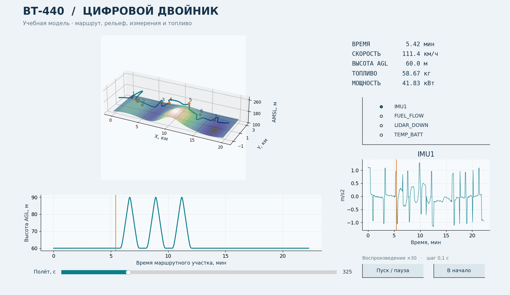

# Цифровой двойник БПЛА ВТ-440

Учебный проект на **Python** по проектной деятельности МАИ. Модель связывает трёхмерную траекторию, рельеф, топливо ДВС, 24 канала измерений и инерциальную навигацию. Есть настольный проигрыватель, двоичная телеметрия, проверки задания, отчёт и презентация с заметками докладчика.

Это автономный программный прототип. Реальное воздушное судно не подключено, параметры двигателя и погрешности датчиков не идентифицированы по лётным испытаниям. Код не управляет БПЛА.



## Быстрый запуск в Windows

Установить Python 3.11 или 3.12 с компонентом Tcl/Tk и открыть PowerShell в папке проекта. Для запуска нужен скачанный **весь репозиторий**.

```powershell
py -3.12 -m venv .venv
.\.venv\Scripts\python.exe -m pip install -r requirements.txt
.\.venv\Scripts\python.exe -m dtwin replay results/reference
```

Команда `replay` сразу открывает сохранённый результат. Кнопки «Пуск / пауза» и «В начало», ползунок времени и выбор сигнала работают локально. Вращать 3D-сцену можно мышью. Новый расчёт:

```powershell
.\.venv\Scripts\python.exe -m dtwin simulate --scenario gnss_dropout --record
.\.venv\Scripts\python.exe -m dtwin gui --scenario gnss_dropout
```

В Linux/macOS использовать `python3` и `.venv/bin/python`. В Linux для оконного интерфейса нужен системный Tcl/Tk. На сервере без экрана использовать `simulate`. После установки библиотек интернет не требуется.

## Реализованное задание

| Требование | Реализация |
|---|---|
| Семь равномерно расположенных препятствий | Центры через 2,5 км, 3D-длины проверяются отдельно |
| Запретная зона | Цилиндр без ограничения высоты, обход +20% от L₀ |
| Три препятствия сверху | AGL ×1,5, боковая коррекция до +4% каждого участка |
| Три оставшихся препятствия | +4%, +5%, +6%; участок +4% содержит пролёт под мостом |
| Полёт по рельефу | Аналитическая поверхность, лесной покров, речной коридор |
| Скорость на манёврах | Ограничения кривизны, крена, вертикальной скорости, ускорения |
| ДВС и топливо | Мощность, расход, изменение массы, посадочный запас ≥3% |
| Сенсоры и БИНС | 24 канала, шумы, плечи установки, признаки недостоверности |
| Частоты и память | Зависимость от скорости, точные размеры 25 потоков с STATE |
| Проверка | Модульные тесты, четыре сценария, контрольная запись |

Неоднозначности зафиксированы в [допущениях](docs/assumptions.md). Самолётные условия о третьем заходе на ВПП не относятся к выбранному вертолётному БПЛА. Сравнение датчиков остальных типов ЛА дано в отчёте.

## Материалы для сдачи

- [Отчёт](docs/Report_VT440.docx)
- [Презентация](docs/Presentation_VT440.pptx)
- [Текст выступления и вопросы](docs/Defense_VT440.docx)
- [Проверяемые результаты](results/reference/results.json)
- [Эксперименты](results/experiments.csv)
- [Протокол тестов](results/test_results.txt)
- [Матрица требований](docs/requirements.md)

## Команды

```text
python -m dtwin simulate --scenario nominal
python -m dtwin simulate --scenario gnss_dropout --record
python -m dtwin simulate --scenario low_fuel --no-navigation
python -m dtwin simulate --scenario strong_wind --no-navigation
python -m dtwin memory --hours 5
python -m dtwin replay results/reference
python -m dtwin gui --scenario nominal
python -m unittest discover -s tests -v
python scripts/run_experiments.py
```

`simulate` возвращает 0 при успешных проверках и 2 при нарушении условий или ошибке конфигурации. `low_fuel` и `strong_wind` показывают выявление недопустимых условий. При недостатке топлива выполняется прогноз маршрута и выдаётся отказ, а не моделирование аварийной посадки.

`--record` создаёт `telemetry/*.bin` и `manifest.json`. Сырые двоичные потоки воспроизводимы и не хранятся в Git. Их фактический размер сверяется с бюджетом. В репозитории есть прореженные CSV, полный маршрут, проверки и графики. В `replay` измерения прорежены до одного отсчёта за 5 с; полный сигнал доступен после нового расчёта.

## Структура

| Каталог | Содержимое |
|---|---|
| dtwin | Действующая модель и интерфейс |
| config | Миссия и 24 канала |
| tests | Численные и интеграционные тесты |
| scripts | Эксперименты, отчёт, сцена Blender |
| results/reference | Контрольный сценарий с отказом GNSS |
| docs | Материалы защиты и допущения |
| src | Исходные наработки и совместимый main.py |
| materials, standard | Предоставленные справочные материалы |

Первоначальные `src/model`, `src/config`, `data/trajectory.csv` и `output/results.json` сохранены как исторические наработки. **Действующие расчёты выполняет `dtwin/` с `config/`; актуальные результаты находятся в `results/`.** Старый `python src/main.py` перенаправлен на новую модель.

## Область применимости

Мир ENU: X на восток, Y на север, Z вверх. Корпус FLU: X вперёд, Y влево, Z вверх. Радианы, секунды и метры. Локальная поверхность Земли плоская. `seed=42` фиксирует шумы. Облёт задаётся заранее; оптимизатор пути и замкнутый автопилот не реализованы. Ориентация согласована с кинематикой, но динамика лопастей и уравнения вращения твёрдого тела не решаются.

120 с взлёта/посадки учитываются как энергетическая надбавка на мощности висения. Маршрут и сырые потоки охватывают только воздушный маршрутный участок. Память на 90 мин и 5 ч рассчитана отдельно.

Дальнейшее развитие: DEM и реальная телеметрия, калибровка двигателя, компоновка и помехи сенсоров, EKF с оценкой смещений, 6DoF и аппаратные испытания. Необязательный `scripts/blender_scene.py` строит схематическую сцену, не CAD-конструкцию производителя.

Для пересборки Word из результатов: `python -m pip install python-docx`, затем `python scripts/build_report.py`. Презентация содержит редактируемые таблицы и диаграммы со встроенными данными; речь по слайдам есть в заметках докладчика.
