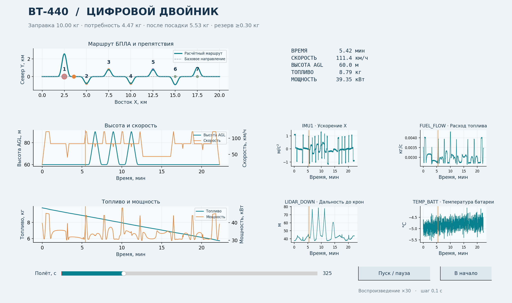

# Цифровой двойник БПЛА ВТ-440

Учебный проект на **Python** по проектной деятельности МАИ. Модель связывает пространственную траекторию, рельеф, топливо ДВС, 24 канала измерений и инерциальную навигацию. В текущей промежуточной версии есть двумерный проигрыватель, двоичная телеметрия и проверки задания. Маршрут, высота, скорость, топливо, мощность и четыре графика датчиков отображаются сразу, без выбора сигнала.

Это автономный программный прототип. Реальное воздушное судно не подключено, параметры двигателя и погрешности датчиков не идентифицированы по лётным испытаниям. Код не управляет БПЛА.



## Быстрый запуск в Windows

Установить Python 3.11 или 3.12 с компонентом Tcl/Tk и открыть PowerShell в папке проекта. Для запуска нужен скачанный **весь репозиторий**.

```powershell
py -3.12 -m venv .venv
.\.venv\Scripts\python.exe -m pip install -r requirements.txt
.\.venv\Scripts\python.exe -m dtwin replay results/reference
```

Команда `replay` сразу открывает сохранённый результат: плоскую карту маршрута, параметры полёта и все четыре графика IMU1, FUEL_FLOW, LIDAR_DOWN и TEMP_BATT. Кнопки «Пуск / пауза», «В начало» и общий ползунок времени работают локально. При перемотке положение БПЛА на карте и отметки времени на всех графиках обновляются вместе. 3D-визуализация и переключатель графиков убраны. Новый расчёт:

```powershell
.\.venv\Scripts\python.exe -m dtwin simulate --scenario gnss_dropout --record
.\.venv\Scripts\python.exe -m dtwin gui --scenario gnss_dropout
```

В Linux/macOS использовать `python3` и `.venv/bin/python`. В Linux для оконного интерфейса нужен системный Tcl/Tk. На сервере без экрана использовать `simulate`. После установки библиотек интернет не требуется.

## Реализованное задание

| Требование | Реализация |
|---|---|
| Семь равномерно расположенных препятствий | Центры через 2,5 км, пространственные длины проверяются отдельно |
| Запретная зона | Цилиндр без ограничения высоты, обход +20% от L₀ |
| Три препятствия сверху | AGL ×1,5, боковая коррекция до +4% каждого участка |
| Три оставшихся препятствия | +4%, +5%, +6%; участок +4% содержит пролёт под мостом |
| Полёт по рельефу | Аналитическая поверхность, лесной покров, речной коридор |
| Скорость на манёврах | Ограничения кривизны, крена, вертикальной скорости, ускорения |
| ДВС и топливо | Мощность, расход, изменение массы, посадочный запас ≥3% |
| Сенсоры и БИНС | 24 канала, шумы, плечи установки, признаки недостоверности |
| Частоты и память | Зависимость от скорости, точные размеры 25 потоков с STATE |
| Проверка | Модульные тесты, четыре сценария, контрольная запись |

Неоднозначности зафиксированы в [допущениях](docs/assumptions.md). Самолётные условия о третьем заходе на ВПП не относятся к выбранному вертолётному БПЛА. Сравнение датчиков остальных типов ЛА дано в отчёте.

## Команда и подготовка к защите

Для каждого участника подготовлена отдельная памятка: выполненная часть, файлы, алгоритм, формулы, проверки и короткий текст выступления.

| Участник | Тема | Материалы |
|---|---|---|
| Дина | Траектория и рельеф | [Памятка Дины](docs/team/dina_route.md) |
| Даня | Топливо и энергия | [Памятка Дани](docs/team/danya_energy.md) |
| Илья | Датчики | [Памятка Ильи](docs/team/ilya_sensors.md) |
| Серёга | Тестирование и формирование отчётов | [Памятка Серёги](docs/team/serega_testing.md) |
| Андрей | Навигация | [Памятка Андрея](docs/team/andrey_navigation.md) |

[Общий порядок работы модулей](docs/team/README.md).

## Перепроверка топлива — 18 ноября 2026

Начальная заправка по умолчанию уменьшена с **60 до 10 кг**. Прежние 60 кг были заданным запасом сценария, а не расходом на маршрут или подтверждённой вместимостью бака. При 10 кг взлётная масса равна 378 кг.

| Режим при заправке 10 кг | Потребность с вылетом и посадкой | Остаток после посадки | Пиковая потребная мощность | Итог |
|---|---:|---:|---:|---|
| Штатный / потеря GNSS | 4,473 кг | 5,527 кг | 48,44 кВт | Проверки сценария пройдены |
| Сильный ветер (−18; 8; 0) м/с | 9,254 кг | 0,746 кг | 153,81 кВт | Топлива достаточно; план отклонён по пределу 85 кВт |

Остаток должен быть не менее 0,3 кг — 3% заправки. Численный минимум заправки составляет около 4,560 кг в штатном режиме и 9,538 кг по топливному критерию при сильном ветре. Это результаты учебной модели для маршрута 29,402 км, а не эксплуатационные рекомендации. При превышении мощности прогноз топлива не подтверждает возможность полёта.

**Паспортный объём бака ВТ-440 в проверенных открытых источниках не найден.** В конфигурации `energy.tank_capacity_l = null`; проверка вместимости явно помечается как невыполненная. 10 кг ≈13,33 л при принятой оценочной плотности 0,75 кг/л. Это объём заправки. Если известна паспортная вместимость, её можно указать в конфигурации: переполнение будет отклонено.

[Расчёт, допущения и источники](docs/fuel_review.md) · [Сравнение заправок](results/fuel_audit.csv) · [Протокол проверки программы](docs/verification.md).

## Материалы для сдачи

Отчёт Word, презентация и прежний текст защиты сохранены от полной версии без пересборки. Их старые числа 60 кг и 55,05 кг относятся к прежней заправке. Актуальные расчёты, проверка программы и персональные памятки приведены выше. Обновление Word и презентации запланировано вместе со следующим этапом — отдельным приложением с собственным интерфейсом. Новые расчёты и проигрыватель используют только двумерные графики.

- [Отчёт](docs/Report_VT440.docx)
- [Презентация](docs/Presentation_VT440.pptx)
- [Текст выступления и вопросы](docs/Defense_VT440.docx)
- [Проверяемые результаты](results/reference/results.json)
- [Эксперименты](results/experiments.csv)
- [Протокол тестов](results/test_results.txt)
- [Матрица требований](docs/requirements.md)

## Команды

```text
python -m dtwin simulate --scenario nominal
python -m dtwin simulate --scenario gnss_dropout --record
python -m dtwin simulate --scenario low_fuel --no-navigation
python -m dtwin simulate --scenario strong_wind --no-navigation
python -m dtwin simulate --fuel-kg 10 --no-navigation
python scripts/check_fuel.py
python -m dtwin memory --hours 5
python -m dtwin replay results/reference
python -m dtwin gui --scenario nominal
python -m unittest discover -s tests -v
python scripts/verify_program.py
python scripts/run_experiments.py
```

`simulate` возвращает 0 при успешных проверках и 2 при нарушении условий или ошибке конфигурации. `low_fuel` и `strong_wind` показывают выявление недопустимых условий. При недостатке топлива выполняется прогноз потребности плана и выдаётся отказ. Содержимое бака остаётся неотрицательным; `fuel_shortfall_kg` показывает дефицит, `fuel_required_kg` — потребность всего плана, `fuel_consumed_kg` — расход доступного топлива. Аварийная посадка не моделируется.

`--record` создаёт `telemetry/*.bin` и `manifest.json`. Сырые двоичные потоки воспроизводимы и не хранятся в Git. Их фактический размер сверяется с бюджетом. В репозитории есть прореженные CSV, полный маршрут, проверки и графики. В `replay` измерения прорежены до одного отсчёта за 5 с; полный сигнал доступен после нового расчёта.

## Структура

| Каталог | Содержимое |
|---|---|
| dtwin | Действующая модель и интерфейс |
| config | Миссия и 24 канала |
| tests | Численные и интеграционные тесты |
| scripts | Эксперименты и сборка отчёта |
| results/reference | Контрольный сценарий с отказом GNSS |
| docs | Материалы защиты и допущения |
| src | Исходные наработки и совместимый main.py |
| materials, standard | Предоставленные справочные материалы |

Первоначальные `src/model`, `src/config`, `data/trajectory.csv` и `output/results.json` сохранены как исторические наработки. **Действующие расчёты выполняет `dtwin/` с `config/`; актуальные результаты находятся в `results/`.** Старый `python src/main.py` перенаправлен на новую модель.

## Область применимости

Мир ENU: X на восток, Y на север, Z вверх. Корпус FLU: X вперёд, Y влево, Z вверх. Радианы, секунды и метры. Локальная поверхность Земли плоская. `seed=42` фиксирует шумы. Облёт задаётся заранее; оптимизатор пути и замкнутый автопилот не реализованы. Ориентация согласована с кинематикой, но динамика лопастей и уравнения вращения твёрдого тела не решаются.

120 с взлёта/посадки учитываются как энергетическая надбавка на мощности висения. Маршрут и сырые потоки охватывают только воздушный маршрутный участок. Память на 90 мин и 5 ч рассчитана отдельно.

Следующий этап — отдельное приложение с собственным интерфейсом и полным функционалом модели. Дальнейшее развитие: DEM и реальная телеметрия, калибровка двигателя, компоновка и помехи сенсоров, EKF с оценкой смещений, 6DoF и аппаратные испытания.

Для пересборки Word из результатов: `python -m pip install python-docx`, затем `python scripts/build_report.py`. Презентация содержит редактируемые таблицы и диаграммы со встроенными данными; речь по слайдам есть в заметках докладчика.
